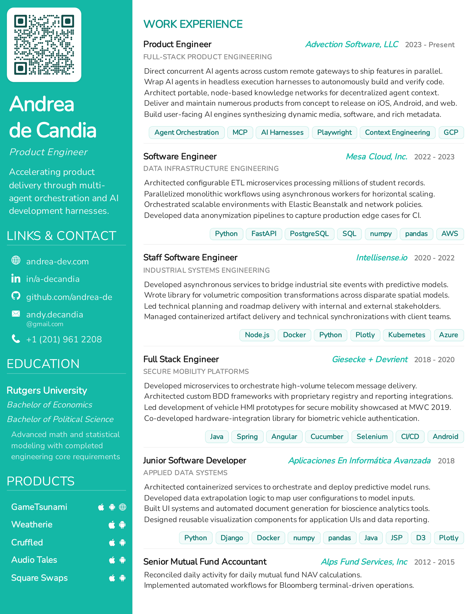

# Resume Project

This resume is built with **Petite-Vue** and **UnoCSS**. It dynamically fetches data from `resume.json` and `icons.json`.

## Quick View


## How to View Locally
Because it fetches external JSON data, it **must be served via a web server** to work correctly.

### Option 1: Using Node.js
```bash
npx serve .
```

### Option 2: Using Python
```bash
python3 -m http.server
```

Once running, visit `http://localhost:3000` (or the port provided) to view the resume.

---

## How to Print (PDF & PNG)
You can generate a PDF and a high-quality PNG preview in one command. This script requires **Google Chrome** (or Chromium) and **poppler-utils** (`pdftoppm`).

### Generate the standard version:
```bash
./print.sh
```

This prints two versions from the same `resume.json`:
- `resume.pdf` / `resume-preview.png`: the US version, with the US phone number.
- `cv.pdf` / `cv-preview.png`: the European version, with the Spanish phone number
  (`index.html?region=eu`). andreadecandia.com serves it to visitors in Europe.

A contact entry with `"region": "us"` or `"region": "eu"` shows only in that version;
entries without a region show in both.

### Generate a custom version for tracking:
This will append tracking parameters to your website links (`?utm_source=resume&utm_campaign=REF_NAME`).

```bash
./utm-print.sh <ref-name> [job-url]
# Example: ./utm-print.sh bobby-at-apple "https://jobs.apple.com/..."
```

This will output:
- `resume-REF_NAME.pdf`
- `resume-REF_NAME-preview.png`

### Generate a version for a personal job link (QR code):
Andrea's site hands out personal job links: the site API returns a 3-character code, and
`https://www.andreadecandia.com/r/<code>` is the link for that company. `ref-print.sh` prints a
résumé whose QR code (top-left of the sidebar) points to that link.

```bash
./ref-print.sh <code> [--region us|eu] [--color <hex>] [--logo-shape <path|url>] [--brand <name>]
# Examples:
./ref-print.sh k7q                                        # US number, default teal QR
./ref-print.sh k7q --region eu                            # Spanish number
./ref-print.sh k7q --color 0b5fff                         # brand-colored QR
./ref-print.sh k7q --color c2410c --logo-shape shape.svg  # the dots form a silhouette
./ref-print.sh k7q --brand stripe                         # the company's logo and color, looked up
```

This will output:
- `resume-<code>.pdf`
- `resume-<code>-preview.png`

The code must be exactly 3 lowercase letters or digits. A local `--logo-shape` file is copied into
the repo as `.qr-logo-*` while printing (the page can only load files the print server can see) and
removed afterwards.

`--brand <name>` does the logo-in-dots lookup for you (made for agents): it finds the company in
[Simple Icons](https://simpleicons.org) (CC0 brand silhouettes: one SVG path plus the official brand
hex each), pinned to `simple-icons@16.30.0` on jsDelivr (`data/simple-icons.json` for the colors,
`icons/<slug>.svg` for the shape), and uses them as `--logo-shape` and `--color`. The name is
matched by Simple Icons' own slug rules (lowercase; `+` → `plus`, `.` → `dot`, `&` → `and`; accents
dropped; anything else not a-z/0-9 removed, so `"AT&T"` → `atandt`, `"Citroën"` → `citroen`), then
by title or alias, case-insensitively. Downloads are cached in `.brand-cache/` (gitignored).
- An explicit `--color` beats the brand color.
- A brand color under 4.5:1 on white (Spotify's green, McDonald's yellow…) prints near-black with
  a grey tint; the script says so.
- Not found (or offline): a note, and a plain QR in `--color` if given, else the default teal. A
  missing brand never stops the print.
- Brand logos are trademarks: only for a one-off résumé sent to that company, never published.

---

## QR Code
The top-left of the sidebar is a QR code on a white rounded tile, the full width of the sidebar
column (inline SVG, so it stays crisp in the PDF; it's also a link). It's drawn from the module matrix of the vendored
[qrcode-generator](https://github.com/kazuhikoarase/qrcode-generator) 1.4.4 (MIT,
`src/vendor/qrcode.js`): dot modules, softly rounded finder eyes, a 4-module quiet zone.

What it encodes, from the `index.html` URL params:
- `?code=k7q` → `https://www.andreadecandia.com/r/k7q`
- no code → `https://www.andreadecandia.com/?utm_source=resume`, plus `&utm_campaign=<ref>` with `?ref=`

Styling params:
- `?qrColor=0b5fff`: module color (hex, no `#`). Colors under 4.5:1 contrast on white can't be
  relied on to scan, so they fall back to near-black with a console warning. Default: dark teal.
- `?qrShape=<path or URL>` (`--logo-shape`, `--brand`): logo-in-dots. A silhouette (SVG, or a PNG read by its
  alpha, or by darkness if it's opaque) is cropped to its bounding box and scaled to 90% of the code;
  the code is forced to version 7 (45×45, larger only if the data needs it) with error correction H.
  Dark modules inside the shape are full dots in the `qrColor` brand color, dark modules outside are
  smaller grey dots, light modules inside get a pale tint of the brand color, and the finder eyes are
  neutral dark. A brand color under 4.5:1 falls back to near-black with a light grey tint. Never
  put a real company's logo on anything published.

Error correction is M for a plain code and H for logo-in-dots. There is no centre-logo option.
- `?qrStyle=square`: plain square modules and eyes, if a scanner ever struggles with the dots.

Keep the finder eyes' outer corners only slightly rounded: rounder rings stop some decoders
(e.g. OpenCV's) from finding the code at all. Keep the outside dots of the logo-in-dots style at
radius 0.4 or more: smaller ones fail zxing once the print is blurred or tilted.

---

## Products
The Products section of the sidebar sits right after Education: a grid of counter pills, 3 equal
pills per row (same width and height), wrapping onto more rows. Each pill shows its icon and number
on top and a caption under it. They come from `resume.json` → `stats`: a `heading` and `items`, in
order, each `{ id, icon, value, caption, label }` (`icon` is a key in `icons.json`; `label` is the
tooltip and accessible text):

| id | icon | value | caption |
| --- | --- | --- | --- |
| android | `android-white` | 4 | Android |
| ios | `apple-white` | 2 | iOS |
| steam | `steam-white` | 0 | Steam |
| web | `globe-white` | 3 | Web apps |
| soon | `rocket-white` | 6 | Coming soon |

A pill whose value is 0 or empty isn't shown, so Steam stays hidden until it has a value. Count
only what is live: Android and iOS are store listings; Web apps are browser apps people can use
(Cruffled, GameTsunami's web app, the Weatherie demo), not landing pages.
`?statsCaptions=0` prints icon and number only.

`resume.json` → `projects` (the old list of products with platform badges) is kept but no
longer shown.

---

## Tracking
The resume automatically tracks clicks to your website by appending UTM parameters. 
- The base link is `?utm_source=resume`.
- Custom campaigns can be added via the script or by visiting `index.html?ref=MY_REF`.
- The QR code carries the same tag (`?utm_source=resume`, plus `utm_campaign` with `?ref=`),
  unless a personal link code is given with `?code=`.
